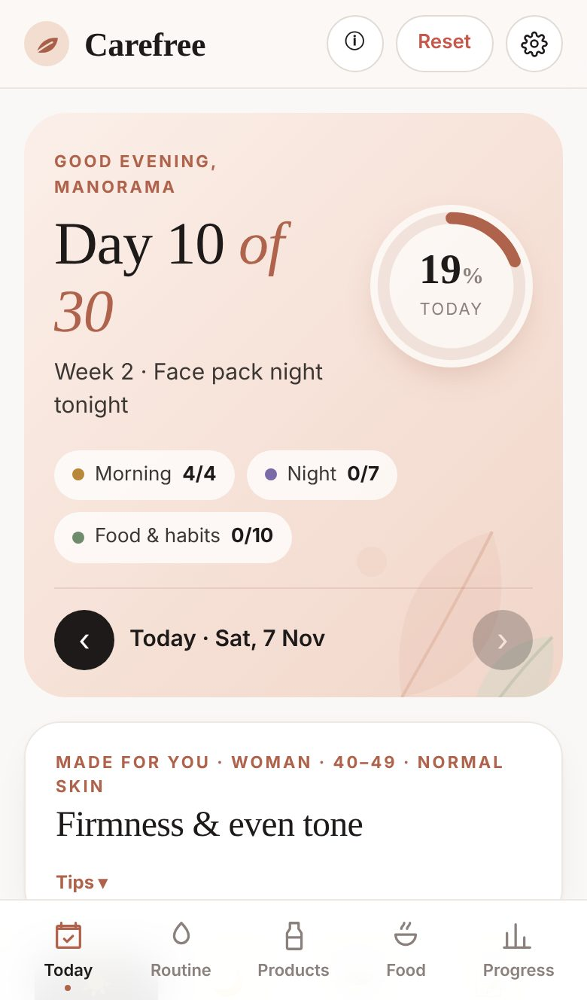
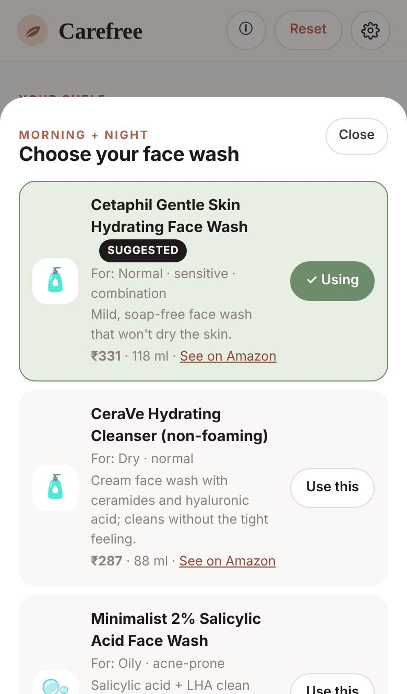
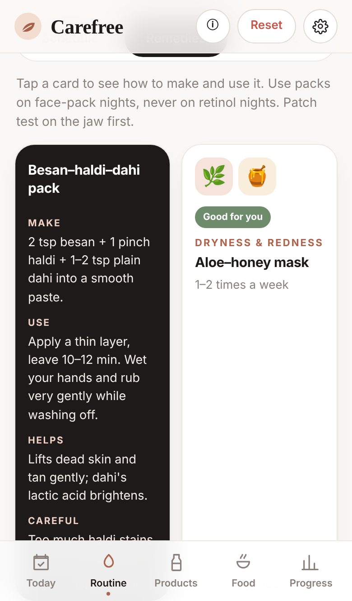
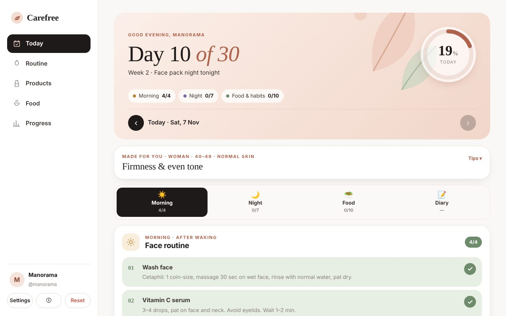
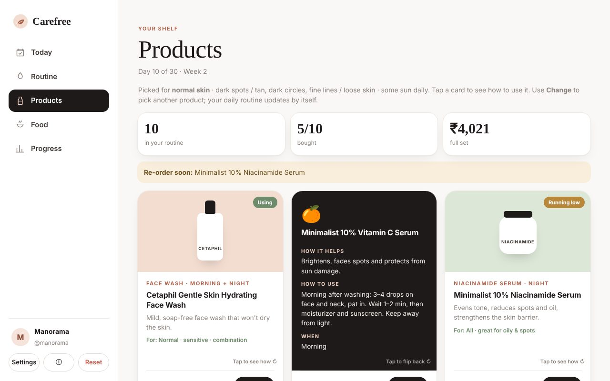
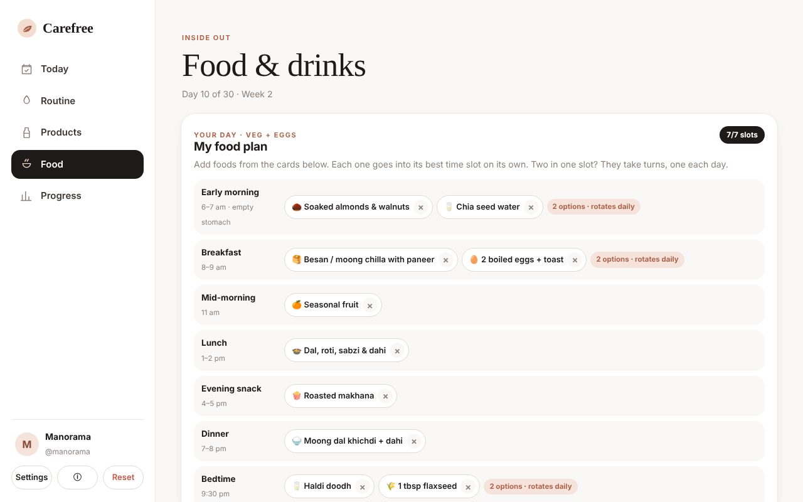
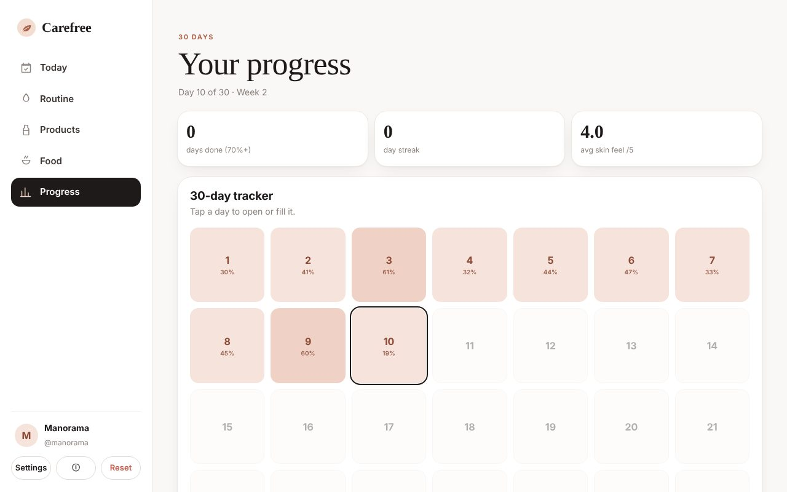
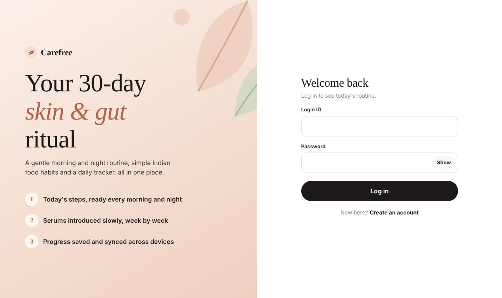

# Carefree: a 30-day skin & gut routine you can actually follow

**Live:** https://carefree-2026.vercel.app

<p align="center">
  
  &nbsp;
  
  &nbsp;
  
</p>

## The real-life problem

I made this for someone close to me. She is 42, has normal skin and low blood pressure, eats mostly vegetarian food, and wanted to do something about dark spots, dark circles and skin that was getting loose. She had seen a lot of tips online and from family, but it was hard to know what to use, in what order, and when.

A few things made it hard to stick to:

- **Too many products, too fast.** Retinol, vitamin C, alpha arbutin and exfoliating acids used together from day one irritate the skin, and people quit in week one.
- **Nobody remembers the order.** Which serum goes first? Retinol on which night? Was it vitamin C in the morning or at night?
- **One routine for everyone.** Oily, acne-prone skin in a 22-year-old needs a different routine from dry skin at 50. Advice online rarely says who it is for.
- **Food is ignored.** Skin depends on protein, water, sleep and gut health, but meal advice is usually a long list with no timing.
- **No feedback loop.** Results take 4–8 weeks. Without a tracker, people can't tell if they were consistent or if a product caused a reaction.

**Carefree turns all of that into one checklist for today.** Answer six questions, and it builds a personal morning and night routine, introduces products slowly week by week, plans food by time of day, and keeps a 30-day record. It works on any phone, and data syncs across devices.

## What it does

| | |
|---|---|
| **Six quick questions** | Woman/man, age group (20s–50+), skin type (normal, dry, oily, combination, sensitive), concerns (dark spots, dark circles, fine lines, acne, dullness, open pores), sun exposure and diet (veg / veg + eggs / non-veg). |
| **Personal routine engine** | Picks only the products a person needs: e.g. salicylic face wash + gel moisturizer for oily, acne-prone skin, or a cream cleanser + hyaluronic acid for dry skin. Someone with no concerns gets a short cleanser–moisturizer–sunscreen routine. |
| **Slow, safe night schedule** | Week 1 gentle basics → spot serum from week 2 → retinol 2 nights in week 3 → 3 nights in week 4 (stays at 2 for sensitive or 50+ skin). Exfoliating nights never sit next to retinol nights. |
| **Today, in four tabs** | Morning · Night · Food · Diary, each a tick-list with counts and a progress ring. Opens on the right tab for the time of day. |
| **Products you can change** | Flip a card to see how it helps and exactly how to use it. "Change" shows alternatives with prices and Amazon links; picking one updates the routine instantly. Track bought / using / running low. |
| **Food planner** | 33 Indian food & drink cards (chia water, amla, sprouts, makhana, dal, fish, haldi doodh…). Adding one puts it in its best time slot: black coffee goes after breakfast, not on an empty stomach. Empty slots and "2 options, rotates daily" are flagged. |
| **Home remedies** | Ten flip cards (besan–dahi, aloe–honey, potato juice for dark circles, rice water toner…) with how to make, how to use, and what to avoid. |
| **Diary & 30-day tracker** | Skin-feel rating, notes, a "redness or burning" flag that switches the night to a calm routine, streaks and a heat-map of the month. |
| **Honest by design** | No paid promotion or affiliate links. An ⓘ button explains that a doctor's advice comes first and lists the sources used. |

<p align="center">
  
  
</p>
<p align="center">
  
  
</p>
<p align="center">
  
</p>

## How it works

- **Next.js 15 (App Router) + React 19 + TypeScript**, deployed on **Vercel**.
- **MongoDB Atlas** stores accounts and daily logs.
- **Auth:** bcrypt-hashed passwords and a signed JWT in an httpOnly, secure cookie (30 days), so people stay logged in. The signing key is generated once and kept in the database, so only `MONGODB_URI` is needed.
- **Live sync:** every tick saves instantly; the app refreshes every 15 s and whenever it comes back to the screen, so a phone and a laptop stay in step.
- **Routine engine** (`lib/routine.ts`): profile → default product per step → user overrides → morning steps, night type per date, night steps and weekly notes.
- **Food planner** (`lib/foods.ts`): each item has one best time slot; several items in a slot rotate by day number.

### Built to use very little storage

The free Atlas tier is 512 MB, so data is kept tiny:

- A day is stored as `{ u, d, c: ["am_wash", …], r, n }`: short keys, and only the steps that are ticked.
- **Unticking removes the entry**; a day with nothing left in it is deleted.
- "Not bought" products, the suggested product for a step, and an unchanged food plan are **not stored at all**; only differences from the suggestions are saved.

A typical day uses about 100–200 bytes, so thousands of people can use the app daily on the free tier.

## Run it yourself

```bash
npm install
cp .env.example .env.local   # add your MONGODB_URI
npm run dev                  # http://localhost:3000
```

**Deploy:** import the repo in Vercel, add `MONGODB_URI` (Atlas: Database Access → user, Network Access → `0.0.0.0/0`), deploy. A starter account is created on first run from `SEED_USERNAME` / `SEED_PASSWORD`; change its password in Settings straight away. `GET /api/health` reports whether the database is reachable.

## Project structure

```
app/            pages (/, /login, /signup) and API routes (auth, me, logs, health)
components/     Dashboard (all tabs), AuthForm, ProfilePicker, PasswordInput, Art
lib/routine.ts  product catalog + personal routine engine
lib/foods.ts    food & drink catalog + time-slot planner
lib/profile.ts  questions, tips by age / gender / skin
lib/remedies.ts home remedies
lib/db.ts       MongoDB connection, indexes, seed user
```

## Disclaimer

General wellness guidance, not medical advice. Patch test every new product, and see a dermatologist for spreading patches, persistent acne, pregnancy or any medication. Product prices were checked on Amazon.in on 7 Nov 2026 and may change.

---

Made by [ashyou09](https://github.com/ashyou09).
